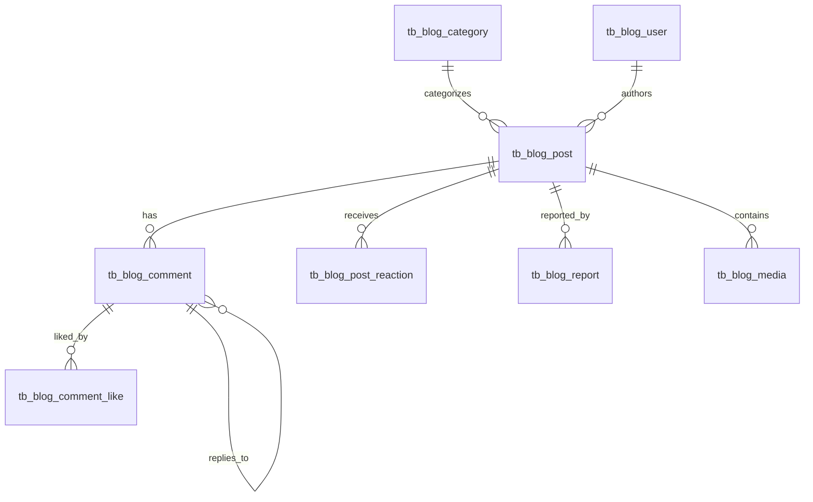

# MdBlog Module - Comprehensive API Documentation

This documentation provides complete endpoint specifications, request payloads, query/route parameters, response structures, and database table mappings for all 42 endpoints in the **MdBlog** module defined in [`MdBlogRoutes.php`](./Services/MdBlogRoutes.php).

---

## Standard Response Envelope Structure

All API responses follow the uniform `LtResponse` format:

```json
{
    "responseResult": "success | Action description",
    "responseCode": 200 | 201 | 2006 | 3004 | 3008 | 3014 - 3019 | 422,
    "responseCategory": 200 | 100,
    "responseData": {} | [] | null
}
```

- **`responseCategory`**: `200` indicates HTTP success / valid operation; `100` indicates a validation or application error.
- **`responseCode`**: Application-specific status code (e.g., `201` for operation completed, `200` for fetch success, `3004`/`3008`/`3014-3019` for validation/authentication failures).
- **`responseResult`**: User-facing message describing the status or outcome.
- **`responseData`**: Result data payload (object, array, primitive, or omitted on simple confirmations).

---

## Table of Contents

1. [Category Management (`tb_blog_category`)](#1-category-management-tb_blog_category)
2. [Tag Management (`tb_blog_tag`)](#2-tag-management-tb_blog_tag)
3. [Post Management (`tb_blog_post`, `tb_blog_post_reaction`, `tb_blog_media`)](#3-post-management-tb_blog_post)
4. [Comment Management (`tb_blog_comment`, `tb_blog_comment_like`)](#4-comment-management-tb_blog_comment)
5. [Report Management (`tb_blog_report`)](#5-report-management-tb_blog_report)
6. [Settings Management (`tb_blog_setting`)](#6-settings-management-tb_blog_setting)
7. [Authentication & User Management (`tb_blog_user`, `tb_user`)](#7-authentication--user-management-tb_blog_user)
8. [Database Schema Reference](#8-database-schema-reference)

---

## 1. Category Management (`tb_blog_category`)

Controller: [`TbBlogCategoryController`](./Controllers/TbBlogCategoryController.php)  
Service: [`TbBlogCategoryService`](./Services/TbBlogCategoryService.php)

### 1.1 List Categories (Select Filter)

Retrieves a lightweight list containing only category IDs and names, ideal for dropdowns and filter selectors.

- **Route:** `GET /blogs/filter/categories`
- **Route Name:** `admin-blog-category.select_filter`
- **Query Parameters:**
  - `status` _(string, optional)_: Filter by status (`isActive` or `isNotActive`).

**Sample Response (Success - 200 OK):**

```json
{
  "responseResult": "success",
  "responseCode": 201,
  "responseCategory": 200,
  "responseData": [
    {
      "ltId": 172600000012345,
      "categoryName": "Technology"
    },
    {
      "ltId": 172600000012346,
      "categoryName": "Design"
    }
  ]
}
```

---

### 1.2 List Categories (Full Index)

Retrieves all category records with full details.

- **Route:** `GET /blogs/categories`
- **Route Name:** `admin-blog-category.index`
- **Query Parameters:**
  - `status` _(string, optional)_: Filter by status (`isActive` or `isNotActive`).

**Sample Response (Success - 200 OK):**

```json
{
  "responseResult": "success",
  "responseCode": 201,
  "responseCategory": 200,
  "responseData": [
    {
      "ltId": 172600000012345,
      "categoryName": "Technology",
      "categoryDescription": "Articles on emerging technologies, gadgets, and innovations.",
      "status": "isActive",
      "showOnMenu": 1,
      "createdBy": null,
      "updatedBy": null,
      "createdAt": "2026-07-10 11:28:48",
      "updatedAt": "2026-07-13 15:24:05"
    }
  ]
}
```

---

### 1.3 Register / Create Category

Creates a new blog category.

- **Route:** `POST /blogs/categories`
- **Route Name:** `admin-blog-category.store`
- **Headers:** `Content-Type: application/json` or `application/x-www-form-urlencoded`

**Request Payload:**

```json
{
  "categoryName": "Artificial Intelligence",
  "categoryDescription": "Articles exploring LLMs, ML, and AI ethics",
  "showOnMenu": 1
}
```

**Sample Response (Success - 201 Created):**

```json
{
  "responseResult": "Registration successful",
  "responseCode": "2006",
  "responseCategory": "200",
  "responseData": {
    "ltId": "179096350529836",
    "categoryName": "Artificial Intelligence",
    "categoryDescription": "Articles exploring LLMs, ML, and AI ethics",
    "showOnMenu": 1,
    "createdAt": "2026-10-04 00:15:00",
    "updatedAt": "2026-10-04 00:15:00"
  }
}
```

**Sample Response (Validation Error - 400):**

```json
{
  "responseResult": "Category name and code is required",
  "responseCode": 3004,
  "responseCategory": 100
}
```

---

### 1.4 Update Category

Updates an existing category record.

- **Route:** `PATCH /blogs/categories/{ltId}`
- **Route Name:** `admin-blog-category.update`
- **Path Parameters:**
  - `ltId` _(integer/string, required)_: The unique ID of the category.

**Request Payload:**

```json
{
  "categoryName": "AI & Machine Learning",
  "categoryDescription": "Deep dives into modern neural networks and AI models",
  "showOnMenu": 1
}
```

**Sample Response (Success):**

```json
{
  "responseResult": "Record Updated",
  "responseCode": "2006",
  "responseCategory": "200",
  "responseData": {
    "ltId": "179096350529836",
    "categoryName": "AI & Machine Learning",
    "categoryDescription": "Deep dives into modern neural networks and AI models",
    "showOnMenu": 1,
    "updatedAt": "2026-10-04 00:18:22"
  }
}
```

**Sample Response (Not Found):**

```json
{
  "responseResult": "Category not found",
  "responseCode": 3004,
  "responseCategory": 100
}
```

---

### 1.5 Toggle Category Active Status

Toggles the status between `isActive` and `isNotActive`.

- **Route:** `PATCH /blogs/categories/{ltId}/toggle-active`
- **Route Name:** `admin-blog-category.toggle_active`
- **Path Parameters:**
  - `ltId` _(integer/string, required)_: Category ID.

**Request Payload:** None (or empty body)

**Sample Response (Success):**

```json
{
  "responseResult": "Updated",
  "responseCode": 201,
  "responseCategory": 200,
  "responseData": {
    "ltId": "179096350529836",
    "isActive": "isNotActive"
  }
}
```

---

### 1.6 Delete Category

Deletes a category from the database.

- **Route:** `DELETE /blogs/categories/{ltId}`
- **Route Name:** `admin-blog-category.delete`
- **Path Parameters:**
  - `ltId` _(integer/string, required)_: Category ID.

**Sample Response (Success):**

```json
{
  "responseResult": "Deleted",
  "responseCode": 201,
  "responseCategory": 200
}
```

---

## 2. Tag Management (`tb_blog_tag`)

Controller: [`TbBlogTagController`](./Controllers/TbBlogTagController.php)  
Service: [`TbBlogTagService`](./Services/TbBlogTagService.php)

### 2.1 List Tags

Retrieves all tags.

- **Route:** `GET /blogs/tags`
- **Route Name:** `admin-blog-tag.index`
- **Query Parameters:**
  - `status` _(string, optional)_: Filter by `isActive` or `isNotActive`.

**Sample Response (Success):**

```json
{
  "responseResult": "success",
  "responseCode": 201,
  "responseCategory": 200,
  "responseData": [
    {
      "ltId": 182600000012357,
      "tagName": "PHP",
      "tagSlug": "php",
      "tagDescription": "PHP server-side scripting language",
      "tagColor": "#777bb4",
      "status": "isActive",
      "createdBy": null,
      "updatedBy": null,
      "createdAt": "2026-08-01 10:00:00",
      "updatedAt": "2026-08-01 10:00:00"
    }
  ]
}
```

---

### 2.2 Create Tag

Registers a new blog tag.

- **Route:** `POST /blogs/tags`
- **Route Name:** `admin-blog-tag.store`

**Request Payload:**

```json
{
  "tagName": "React",
  "tagSlug": "react",
  "tagDescription": "A JavaScript library for building user interfaces",
  "tagColor": "#61dafb"
}
```

**Sample Response (Success):**

```json
{
  "responseResult": "Registration successful",
  "responseCode": "2006",
  "responseCategory": "200",
  "responseData": {
    "ltId": "182600000012358",
    "tagName": "React",
    "tagSlug": "react",
    "tagDescription": "A JavaScript library for building user interfaces",
    "tagColor": "#61dafb",
    "createdAt": "2026-10-04 00:20:00",
    "updatedAt": "2026-10-04 00:20:00"
  }
}
```

---

### 2.3 Update Tag

Updates an existing tag.

- **Route:** `PATCH /blogs/tags/{ltId}`
- **Route Name:** `admin-blog-tag.update`
- **Path Parameters:**
  - `ltId` _(integer/string, required)_: Tag ID.

**Request Payload:**

```json
{
  "tagName": "ReactJS",
  "tagSlug": "reactjs",
  "tagDescription": "Frontend JavaScript Framework",
  "tagColor": "#00d8ff"
}
```

**Sample Response (Success):**

```json
{
  "responseResult": "Record Updated",
  "responseCode": "2006",
  "responseCategory": "200",
  "responseData": {
    "ltId": "182600000012358",
    "tagName": "ReactJS",
    "tagSlug": "reactjs",
    "tagDescription": "Frontend JavaScript Framework",
    "tagColor": "#00d8ff",
    "updatedAt": "2026-10-04 00:22:00"
  }
}
```

---

### 2.4 Toggle Tag Active Status

Toggles tag status between `isActive` and `isNotActive`.

- **Route:** `PATCH /blogs/tags/{ltId}/toggle-active`
- **Route Name:** `admin-blog-tag.toggle_active`
- **Path Parameters:**
  - `ltId` _(integer/string, required)_: Tag ID.

**Sample Response (Success):**

```json
{
  "responseResult": "Updated",
  "responseCode": 201,
  "responseCategory": 200,
  "responseData": {
    "ltId": "182600000012358",
    "isActive": "isNotActive"
  }
}
```

---

### 2.5 Delete Tag

Removes a tag.

- **Route:** `DELETE /blogs/tags/{ltId}`
- **Route Name:** `admin-blog-tag.delete`
- **Path Parameters:**
  - `ltId` _(integer/string, required)_: Tag ID.

**Sample Response (Success):**

```json
{
  "responseResult": "Deleted",
  "responseCode": 201,
  "responseCategory": 200
}
```

---

## 3. Post Management (`tb_blog_post`)

Controller: [`TbBlogPostController`](./Controllers/TbBlogPostController.php)  
Service: [`TbBlogPostService`](./Services/TbBlogPostService.php)

### 3.1 Filter & Search Posts (Public/Paginated)

Provides paginated, filtered, and sorted post listings for frontend catalogs.

- **Route:** `GET /blogs/filter/posts`
- **Route Name:** `admin-blog-post.post_filter`
- **Query Parameters:**
  - `page` _(int, default: 1)_: Current page number.
  - `limit` _(int, default: 12)_: Number of items per page.
  - `category` _(int/string, optional)_: Category `ltId` (passing `1` or `0` fetches all categories).
  - `q` _(string, optional)_: Keyword to search in `title` or `excerpt`.
  - `sort` _(string, optional)_:
    - `latest` _(default)_: `p.published_at DESC`
    - `oldest`: `p.published_at ASC`
    - `popular`: `p.view_count DESC, p.published_at DESC`
    - `liked`: `p.like_count DESC, p.published_at DESC`
    - `comments`: `p.comment_count DESC, p.published_at DESC`
    - `title_asc`: `p.title ASC`
    - `title_desc`: `p.title DESC`

**Sample Response (Success):**

```json
{
  "responseResult": "Posts retrieved successfully",
  "responseCode": 200,
  "responseCategory": 200,
  "responseData": {
    "data": [
      {
        "ltId": "179080640120321",
        "title": "Getting Started with Modern Web Architecture",
        "slug": "getting-started-with-modern-web-architecture",
        "excerpt": "A deep dive into decoupled full-stack design patterns.",
        "readingTime": 5,
        "categoryId": "172600000012345",
        "category": "Technology",
        "date": "2026-09-20 14:00:00",
        "likes": 42,
        "views": 1280,
        "authorId": "179092647320871",
        "author": "John Doe",
        "avatar": "storage/uploads/blogs/profile_179092647320871/avatar_67001.webp",
        "isFeatured": 1,
        "media": [
          {
            "postId": "179080640120321",
            "mediaCategory": "gallery",
            "mediaId": "179080777123456",
            "originalName": "cover.jpg",
            "mimeType": "image/jpeg",
            "fileSize": 184320,
            "storagePath": "storage/uploads/blogs/post_179080640120321/media_67001.jpg",
            "altText": "Article Banner",
            "filename": "media_67001.jpg"
          }
        ]
      }
    ],
    "pagination": {
      "totalItems": 1,
      "totalPages": 1,
      "currentPage": 1,
      "itemsPerPage": 12,
      "hasMore": false
    }
  }
}
```

---

### 3.2 Posts Widget (Popular, Trending, Related, Latest)

Fetches curated post widgets for sidebars and footers.

- **Route:** `GET /blogs/posts/widget`
- **Route Name:** `admin-blog-post.post_widget`
- **Query Parameters:**
  - `type` _(string, default: `latest`)_: Widget algorithm:
    - `popular`: Highest `view_count`
    - `trending`: Weighted algorithm over views, likes, and comments from the past 14 days
    - `related`: Same category, excluding current post (`postId` and `categoryId` required)
    - `latest`: Newest published posts
  - `limit` _(int, default: 12)_: Number of items.
  - `postId` _(string, optional)_: Used with `type=related` to exclude current post.
  - `categoryId` _(string, optional)_: Used with `type=related` to filter target category.

**Sample Response (Success):**

```json
{
  "responseResult": "success",
  "responseCode": 200,
  "responseCategory": 200,
  "responseData": [
    {
      "ltId": "179080640120321",
      "title": "Getting Started with Modern Web Architecture",
      "slug": "getting-started-with-modern-web-architecture",
      "excerpt": "A deep dive into decoupled full-stack design patterns.",
      "readingTime": 5,
      "categoryId": "172600000012345",
      "category": "Technology",
      "date": "2026-09-20 14:00:00",
      "likes": 42,
      "views": 1280,
      "authorId": "179092647320871",
      "author": "John Doe",
      "avatar": "storage/uploads/blogs/profile_179092647320871/avatar_67001.webp",
      "media": []
    }
  ]
}
```

---

### 3.3 Get Post by Slug (Full Article View)

Fetches the complete post record including body content, author details, current user reaction, media attachments, and nested comments.

- **Route:** `GET /blogs/posts/{slug}/slug`
- **Route Name:** `admin-blog-post.post_slug`
- **Path Parameters:**
  - `slug` _(string, required)_: The unique slug identifier of the post.

**Sample Response (Success):**

```json
{
  "responseResult": "success",
  "responseCode": 200,
  "responseCategory": 200,
  "responseData": {
    "ltId": "179080640120321",
    "title": "Getting Started with Modern Web Architecture",
    "slug": "getting-started-with-modern-web-architecture",
    "excerpt": "A deep dive into decoupled full-stack design patterns.",
    "content": "<p>Full markdown/HTML article content...</p>",
    "readingTime": 5,
    "categoryId": "172600000012345",
    "category": "Technology",
    "date": "2026-09-20 14:00:00",
    "likes": 42,
    "views": 1280,
    "authorId": "179092647320871",
    "createdAt": "2026-09-18 09:20:00",
    "author": "John Doe",
    "avatar": "storage/uploads/blogs/profile_179092647320871/avatar_67001.webp",
    "linkedin": "https://linkedin.com/in/johndoe",
    "twitter": "johndoe",
    "facebook": "johndoe",
    "bio": "Lead Software Architect",
    "userReaction": "like",
    "media": [
      {
        "postId": "179080640120321",
        "mediaCategory": "gallery",
        "mediaId": "179080777123456",
        "filename": "media_67001.jpg"
      }
    ],
    "comments": [
      {
        "ltId": "179092866565526",
        "postId": "179080640120321",
        "userId": "179092647320872",
        "parentId": null,
        "body": "Great article! Very comprehensive.",
        "status": "approved",
        "likes": 3,
        "createdAt": "2026-09-21 11:00:00",
        "author": "Jane Smith",
        "avatar": "",
        "isLikedByUser": 1,
        "replies": []
      }
    ]
  }
}
```

---

### 3.4 List Posts (Admin / Author Index)

Lists all posts for administrative management or filtered by author.

- **Route:** `GET /blogs/posts`
- **Route Name:** `admin-blog-post.index`
- **Query Parameters:**
  - `status` _(string, optional)_: Filter by `draft`, `pending`, `published`, `archived`, etc.
  - `id` _(string/int, optional)_: Filter by author ID (`authorId`).

**Sample Response (Success):**

```json
{
  "responseResult": "success",
  "responseCode": 201,
  "responseCategory": 200,
  "responseData": [
    {
      "ltId": 179080640120321,
      "authorId": 179092647320871,
      "categoryId": 172600000012345,
      "title": "Getting Started with Modern Web Architecture",
      "slug": "getting-started-with-modern-web-architecture",
      "status": "published",
      "viewCount": 1280,
      "likeCount": 42,
      "commentCount": 1,
      "media": []
    }
  ]
}
```

---

### 3.5 Create Post

Creates a new post and handles embedded content images as well as gallery media attachments.

- **Route:** `POST /blogs/posts`
- **Route Name:** `admin-blog-post.store`
- **Content-Type:** `multipart/form-data`

**Request Payload Fields:**
| Field | Type | Required | Description |
|---|---|---|---|
| `title` | string | Yes | Post title |
| `slug` | string | Yes | Unique URL-friendly slug |
| `categoryId` | integer | No | Category ID (`tb_blog_category.lt_id`) |
| `excerpt` | string | No | Short summary |
| `content` | string | No | Post body (HTML / Markdown). Base64 images are auto-converted to files. |
| `seoTitle` | string | No | Meta title |
| `seoDescription`| string | No | Meta description |
| `readingTime` | integer | No | Estimated minutes to read |
| `status` | enum | No | `draft`, `pending`, `published`, `private`, `scheduled`, `archived` |
| `allowedComment`| string | No | `'on'` to enable comments |
| `showOnMenu` | integer | No | `1` or `0` |
| `isFeatured` | integer | No | `1` or `0` |
| `coAuthors` | json | No | Array of co-author user IDs |
| `author` | integer | No | Override author ID (defaults to current session user) |
| `additionalMedia[]` | file(s) | No | File upload array for gallery media |

**Sample Response (Success - 200/201):**

```json
{
  "responseResult": "Registration successful",
  "responseCode": "2006",
  "responseCategory": "200",
  "responseData": {
    "ltId": "179098765432100",
    "title": "Building Scalable Microservices",
    "slug": "building-scalable-microservices",
    "status": "published",
    "createdAt": "2026-10-04 00:25:00",
    "updatedAt": "2026-10-04 00:25:00"
  }
}
```

---

### 3.6 Update Post

Updates an existing post, cleans up replaced images, and manages additional media uploads/deletions.

- **Route:** `PATCH /blogs/posts/{ltId}`
- **Route Name:** `admin-blog-post.update`
- **Path Parameters:**
  - `ltId` _(string/int, required)_: Post ID.
- **Content-Type:** `multipart/form-data` or `application/json`

**Request Payload:**
Same fields as Create Post, plus:

- `deletedMedia` _(string, optional)_: JSON-encoded array of media IDs to remove (e.g. `"[179080777123456]"`).
- `additionalMedia[]` _(files, optional)_: New media files to add.

**Sample Response (Success):**

```json
{
  "responseResult": "Record Updated",
  "responseCode": "2006",
  "responseCategory": "200",
  "responseData": {
    "ltId": "179098765432100",
    "title": "Building Scalable Microservices (Revised)",
    "slug": "building-scalable-microservices",
    "updatedAt": "2026-10-04 00:30:00"
  }
}
```

---

### 3.7 Toggle Post Active / Status

Toggles status between `isActive` and `isNotActive`.

- **Route:** `PATCH /blogs/posts/{ltId}/toggle-active`
- **Route Name:** `admin-blog-post.toggle_active`
- **Path Parameters:**
  - `ltId` _(string/int, required)_: Post ID.

**Sample Response (Success):**

```json
{
  "responseResult": "Updated",
  "responseCode": 201,
  "responseCategory": 200,
  "responseData": {
    "ltId": "179098765432100",
    "isActive": "isNotActive"
  }
}
```

---

### 3.8 Delete Post

Deletes post record, deletes associated media rows and physical upload folder.

- **Route:** `DELETE /blogs/posts/{ltId}`
- **Route Name:** `admin-blog-post.delete`
- **Path Parameters:**
  - `ltId` _(string/int, required)_: Post ID.

**Sample Response (Success):**

```json
{
  "responseResult": "Deleted successfully",
  "responseCode": 201,
  "responseCategory": 200
}
```

---

### 3.9 Increment Post Views

Increments the `view_count` for a specific post identified by slug.

- **Route:** `POST /blogs/posts/view-update`
- **Route Name:** `admin-blog-post.views-update`

**Request Payload:**

```json
{
  "slug": "getting-started-with-modern-web-architecture"
}
```

**Sample Response (Success):**

```json
{
  "responseResult": "Record Updated",
  "responseCode": "2006",
  "responseCategory": "200",
  "responseData": {
    "ltId": "179080640120321",
    "viewCount": 1281
  }
}
```

---

### 3.10 React to Post

Records or updates a user reaction on a blog post.

- **Route:** `POST /blogs/posts/react`
- **Route Name:** `admin-blog-post.update-reaction`

**Request Payload:**

```json
{
  "postSlug": "getting-started-with-modern-web-architecture",
  "reaction": "like"
}
```

_Valid `reaction` values:_ `'like'`, `'love'`, `'laugh'`, `'wow'`, `'sad'`, `'angry'`, `'celebrate'`, `'dislike'`.

**Sample Response (Success):**

```json
{
  "responseResult": "Reaction recorded successfully",
  "responseCode": 201,
  "responseCategory": 200
}
```

---

### 3.11 Category Post Menu Hierarchy

Returns a nested menu structure grouped by category for header/navigation rendering.

- **Route:** `GET /blogs/menu/categories`
- **Route Name:** `admin-blog-post.menu-categories`

**Sample Response (Success):**

```json
{
  "responseResult": "fetched",
  "responseCode": 201,
  "responseCategory": 200,
  "responseData": {
    "title": "Blog",
    "ltId": 172600000099999,
    "children": [
      {
        "ltId": 172600000012345,
        "title": "Technology",
        "children": [
          {
            "title": "Getting Started with Modern Web Architecture",
            "ltId": 179080640120321
          }
        ]
      }
    ]
  }
}
```

---

## 4. Comment Management (`tb_blog_comment`)

Controller: [`TbBlogCommentController`](./Controllers/TbBlogCommentController.php)  
Service: [`TbBlogCommentService`](./Services/TbBlogCommentService.php)

### 4.1 List Comments (Hierarchical Tree)

Retrieves all comments formatted into a nested comment/reply tree with post title and author metadata.

- **Route:** `GET /blogs/comments`
- **Route Name:** `admin-blog-comment.index`

**Sample Response (Success):**

```json
{
  "responseResult": "success",
  "responseCode": 201,
  "responseCategory": 200,
  "responseData": [
    {
      "ltId": "179092866565526",
      "postId": "179080640120321",
      "userId": "179092647320872",
      "parentId": null,
      "postSlug": "getting-started-with-modern-web-architecture",
      "title": "Getting Started with Modern Web Architecture",
      "authorId": "179092647320871",
      "body": "Insightful read!",
      "status": "approved",
      "likes": 5,
      "createdAt": "2026-09-21 12:00:00",
      "updatedAt": "2026-09-21 12:00:00",
      "commentedBy": "Alice Walker",
      "postAuthor": "John Doe",
      "replies": [
        {
          "ltId": "179092866565527",
          "postId": "179080640120321",
          "userId": "179092647320871",
          "parentId": "179092866565526",
          "body": "Thank you, Alice!",
          "status": "approved",
          "likes": 1,
          "commentedBy": "John Doe",
          "replies": []
        }
      ]
    }
  ]
}
```

---

### 4.2 Create Comment / Reply

Posts a top-level comment or a nested reply to an existing comment.

- **Route:** `POST /blogs/comments/create`
- **Route Name:** `admin-blog-comment.create`

**Request Payload:**

```json
{
  "postSlug": "getting-started-with-modern-web-architecture",
  "body": "Thank you for the clear explanations!",
  "parentId": ""
}
```

_Note: For a nested reply, provide the parent comment ID in `parentId`._

**Sample Response (Success):**

```json
{
  "responseResult": "Registration successful",
  "responseCode": "2006",
  "responseCategory": "200",
  "responseData": {
    "ltId": "179092866565530",
    "postId": "179080640120321",
    "userId": "179092647320872",
    "parentId": null,
    "body": "Thank you for the clear explanations!",
    "status": "approved",
    "createdAt": "2026-10-04 00:35:00",
    "updatedAt": "2026-10-04 00:35:00",
    "postSlug": "getting-started-with-modern-web-architecture",
    "author": "Alice Walker"
  }
}
```

---

### 4.3 Like / Unlike Comment

Toggles like status for the logged-in user and increments/decrements `like_count`.

- **Route:** `POST /blogs/comments/like`
- **Route Name:** `admin-blog-report.comments-like`

**Request Payload:**

```json
{
  "commentId": "179092866565526"
}
```

**Sample Response (Liked):**

```json
{
  "responseResult": "success",
  "responseCode": 201,
  "responseCategory": 200,
  "responseData": "liked"
}
```

**Sample Response (Unliked):**

```json
{
  "responseResult": "success",
  "responseCode": 201,
  "responseCategory": 200,
  "responseData": "unliked"
}
```

---

### 4.4 Delete Comment

Deletes a comment by ID.

- **Route:** `DELETE /blogs/comments/{ltId}`
- **Route Name:** `admin-blog-comments.delete`
- **Path Parameters:**
  - `ltId` _(string/int, required)_: Comment ID.

**Sample Response (Success):**

```json
{
  "responseResult": "Record Deleted",
  "responseCode": "2006",
  "responseCategory": "200"
}
```

---

### 4.5 Update Comment Status

Moderates a comment by updating its status.

- **Route:** `POST /blogs/comments/update-status`
- **Route Name:** `admin-blog-comments.update-status`

**Request Payload:**

```json
{
  "ltId": "179092866565526",
  "status": "spam"
}
```

_Valid `status` options:_ `'pending'`, `'approved'`, `'spam'`, `'deleted'`.

**Sample Response (Success):**

```json
{
  "responseResult": "Record Updated",
  "responseCode": "2006",
  "responseCategory": "200",
  "responseData": {
    "ltId": "179092866565526",
    "status": "spam",
    "updatedAt": "2026-10-04 00:38:00"
  }
}
```

---

## 5. Report Management (`tb_blog_report`)

Controller: [`TbBlogReportController`](./Controllers/TbBlogReportController.php)  
Service: [`TbBlogReportService`](./Services/TbBlogReportService.php)

### 5.1 Submit Report

Flags a post for content moderation.

- **Route:** `POST /blogs/reports/create`
- **Route Name:** `admin-blog-report.create`

**Request Payload:**

```json
{
  "postSlug": "getting-started-with-modern-web-architecture",
  "reason": "spam",
  "comments": "Contains unsolicited external promotional affiliate links."
}
```

_Valid `reason` options:_ `'spam'`, `'harassment'`, `'hate_speech'`, `'copyright'`, `'other'`.

**Sample Response (Success):**

```json
{
  "responseResult": "Registration successful",
  "responseCode": "2006",
  "responseCategory": "200",
  "responseData": {
    "ltId": "179061877176644",
    "postId": "179080640120321",
    "userId": "179092647320872",
    "reason": "spam",
    "comments": "Contains unsolicited external promotional affiliate links.",
    "createdAt": "2026-10-04 00:40:00",
    "updatedAt": "2026-10-04 00:40:00"
  }
}
```

---

### 5.2 List Reports

Retrieves all submitted moderation reports.

- **Route:** `GET /blogs/reports`
- **Route Name:** `admin-blog-report.index`

**Sample Response (Success):**

```json
{
  "responseResult": "success",
  "responseCode": 201,
  "responseCategory": 200,
  "responseData": [
    {
      "ltId": "179061877176644",
      "postId": "179080640120321",
      "userId": "179092647320872",
      "postSlug": "getting-started-with-modern-web-architecture",
      "title": "Getting Started with Modern Web Architecture",
      "author_id": "179092647320871",
      "comments": "Contains unsolicited external promotional affiliate links.",
      "reason": "spam",
      "status": "pending",
      "createdAt": "2026-10-04 00:40:00",
      "updatedAt": "2026-10-04 00:40:00",
      "reportedBy": "Alice Walker",
      "postAuthor": "John Doe"
    }
  ]
}
```

---

### 5.3 Delete Report

Removes a report record.

- **Route:** `DELETE /blogs/reports/{ltId}`
- **Route Name:** `admin-blog-report.delete`
- **Path Parameters:**
  - `ltId` _(string/int, required)_: Report ID.

**Sample Response (Success):**

```json
{
  "responseResult": "Record Deleted",
  "responseCode": "2006",
  "responseCategory": "200"
}
```

---

### 5.4 Update Report Status

Updates report review status.

- **Route:** `POST /blogs/reports/update-status`
- **Route Name:** `admin-blog-report.update-status`

**Request Payload:**

```json
{
  "ltId": "179061877176644",
  "status": "reviewed"
}
```

_Valid `status` options:_ `'pending'`, `'reviewed'`, `'dismissed'`, `'action_taken'`.

**Sample Response (Success):**

```json
{
  "responseResult": "Record Updated",
  "responseCode": "2006",
  "responseCategory": "200",
  "responseData": {
    "ltId": "179061877176644",
    "status": "reviewed",
    "updatedAt": "2026-10-04 00:42:00"
  }
}
```

---

## 6. Settings Management (`tb_blog_setting`)

Controller: [`TbBlogSettingController`](./Controllers/TbBlogSettingController.php)  
Service: [`TbBlogSettingService`](./Services/TbBlogSettingService.php)

### 6.1 List Settings

Retrieves all configuration settings.

- **Route:** `GET /blogs/settings`
- **Route Name:** `admin-blog-setting.index`
- **Query Parameters:**
  - `status` _(string, optional)_: Filter by `isActive` or `isNotActive`.

**Sample Response (Success):**

```json
{
  "responseResult": "success",
  "responseCode": 201,
  "responseCategory": 200,
  "responseData": [
    {
      "ltId": 172600000099999,
      "settingKey": "blog_menu",
      "settingValue": "Tech & Guides",
      "status": "isActive",
      "createdAt": "2026-07-01 10:00:00",
      "updatedAt": "2026-07-01 10:00:00"
    }
  ]
}
```

---

### 6.2 Create Setting

Registers a new setting key-value pair.

- **Route:** `POST /blogs/settings`
- **Route Name:** `admin-blog-setting.store`

**Request Payload:**

```json
{
  "settingName": "posts_per_page",
  "settingValue": "10"
}
```

**Sample Response (Success):**

```json
{
  "responseResult": "Registration successful",
  "responseCode": "2006",
  "responseCategory": "200",
  "responseData": {
    "ltId": "172600000099988",
    "settingKey": "posts_per_page",
    "settingValue": "10",
    "createdAt": "2026-10-04 00:45:00",
    "updatedAt": "2026-10-04 00:45:00"
  }
}
```

---

### 6.3 Update Setting

Updates setting value.

- **Route:** `PATCH /blogs/settings/{ltId}`
- **Route Name:** `admin-blog-setting.update`
- **Path Parameters:**
  - `ltId` _(string/int, required)_: Setting ID.

**Request Payload:**

```json
{
  "settingValue": "15"
}
```

**Sample Response (Success):**

```json
{
  "responseResult": "Record Updated",
  "responseCode": "2006",
  "responseCategory": "200",
  "responseData": {
    "ltId": "172600000099988",
    "settingValue": "15",
    "updatedAt": "2026-10-04 00:46:00"
  }
}
```

---

### 6.4 Toggle Setting Active Status

Toggles setting status between `isActive` and `isNotActive`.

- **Route:** `PATCH /blogs/settings/{ltId}/toggle-active`
- **Route Name:** `admin-blog-setting.toggle_active`
- **Path Parameters:**
  - `ltId` _(string/int, required)_: Setting ID.

**Sample Response (Success):**

```json
{
  "responseResult": "Updated",
  "responseCode": 201,
  "responseCategory": 200,
  "responseData": {
    "ltId": "172600000099988",
    "isActive": "isNotActive"
  }
}
```

---

### 6.5 Delete Setting

Deletes a setting row.

- **Route:** `DELETE /blogs/settings/{ltId}`
- **Route Name:** `admin-blog-setting.delete`
- **Path Parameters:**
  - `ltId` _(string/int, required)_: Setting ID.

**Sample Response (Success):**

```json
{
  "responseResult": "Deleted",
  "responseCode": 201,
  "responseCategory": 200
}
```

---

## 7. Authentication & User Management (`tb_blog_user`)

Controller: [`TbBlogUserController`](./Controllers/TbBlogUserController.php)  
Service: [`TbBlogUserService`](./Services/TbBlogUserService.php)

### 7.1 User Signup / Registration

Registers both a primary system user account (`tb_user`) and a corresponding blog author profile (`tb_blog_user`).

- **Route:** `POST /blogs/auth/signup`
- **Route Name:** `admin-blog-post.sign-up`

**Request Payload:**

```json
{
  "name": "Sarah Connor",
  "username": "sarahconnor",
  "email": "sarah@example.com",
  "password": "SecurePassword123!",
  "confirmPass": "SecurePassword123!"
}
```

**Sample Response (Success):**

```json
{
  "responseResult": "Registration successful",
  "responseCode": "2006",
  "responseCategory": "200",
  "responseData": {
    "ltId": "179092647320875",
    "userId": "179092647320875",
    "username": "sarahconnor",
    "email": "sarah@example.com",
    "fullname": "Sarah Connor",
    "createdAt": "2026-10-04 00:48:00",
    "updatedAt": "2026-10-04 00:48:00"
  }
}
```

**Sample Error Responses:**

```json
// Passwords mismatch
{
    "responseResult": "Passwords do not match!",
    "responseCode": 3014,
    "responseCategory": 100
}

// Password too short (< 8 chars)
{
    "responseResult": "Password must be at least 8 characters!",
    "responseCode": 3016,
    "responseCategory": 100
}

// User already exists
{
    "responseResult": "User record already exist",
    "responseCode": 3017,
    "responseCategory": 100
}
```

---

### 7.2 User Signin / Login

Authenticates user with username or email, records login audit trail, and creates session.

- **Route:** `POST /blogs/auth/signin`
- **Route Name:** `admin-blog-post.sign-in`

**Request Payload:**

```json
{
  "email": "sarah@example.com",
  "password": "SecurePassword123!"
}
```

**Sample Response (Success):**

```json
{
  "responseResult": "Login Successful",
  "responseCode": 200,
  "responseCategory": 200,
  "responseData": {
    "userId": "179092647320875",
    "username": "sarahconnor",
    "email": "sarah@example.com"
  }
}
```

**Sample Error Response (Invalid credentials):**

```json
{
  "responseResult": "No User Found, check your login credentials",
  "responseCode": 3018,
  "responseCategory": 100
}
```

---

### 7.3 Get User Record & Profile

Fetches complete author profile with authored articles and user comments.

- **Route:** `GET /blogs/user/{userId}/record`
- **Route Name:** `admin-blog-post.user-record`
- **Path Parameters:**
  - `userId` _(string/int, required)_: User ID.

**Sample Response (Success):**

```json
{
  "responseResult": "Success",
  "responseCode": 3004,
  "responseCategory": 200,
  "responseData": {
    "ltId": "179092647320871",
    "username": "johndoe",
    "email": "john@example.com",
    "fullname": "John Doe",
    "avatar": "storage/uploads/blogs/profile_179092647320871/avatar_67001.webp",
    "bio": "Lead Software Architect",
    "location": "San Francisco, CA",
    "facebook": "johndoe",
    "twitter": "johndoe",
    "linkedin": "https://linkedin.com/in/johndoe",
    "joined": "2026-06-15 10:20:00",
    "posts": [
      {
        "ltId": "179080640120321",
        "title": "Getting Started with Modern Web Architecture",
        "slug": "getting-started-with-modern-web-architecture",
        "media": []
      }
    ],
    "comments": [
      {
        "ltId": "179092866565526",
        "postId": "179080640120321",
        "postTitle": "Getting Started with Modern Web Architecture",
        "body": "Insightful read!"
      }
    ]
  }
}
```

---

### 7.4 Update User Profile

Updates author information and handles avatar image upload.

- **Route:** `POST /blogs/user/update`
- **Route Name:** `admin-blog-post.user-update`
- **Content-Type:** `multipart/form-data` or `application/json`

**Request Payload:**

```json
{
  "ltId": "179092647320871",
  "fullname": "John Doe, PhD",
  "bio": "Senior Systems Architect & Tech Writer",
  "location": "New York, USA",
  "facebook": "johndoe.tech",
  "twitter": "johndoedev",
  "linkedin": "https://linkedin.com/in/johndoedev"
}
```

_Optional File Upload:_

- `avatarFile`: Image file (`image/jpeg`, `image/png`, `image/webp`).

**Sample Response (Success):**

```json
{
  "responseResult": "Record Updated",
  "responseCode": "2006",
  "responseCategory": "200",
  "responseData": {
    "ltId": "179092647320871",
    "fullname": "John Doe, PhD",
    "bio": "Senior Systems Architect & Tech Writer",
    "avatar": "storage/uploads/blogs/profile_179092647320871/avatar_67002.png",
    "updatedAt": "2026-10-04 00:50:00"
  }
}
```

---

### 7.5 Change User Password

Verifies current password and updates encrypted hash in core user table.

- **Route:** `POST /blogs/user/change-password`
- **Route Name:** `admin-blog-post.change-passowrd`

**Request Payload:**

```json
{
  "userId": "179092647320871",
  "currentPassword": "OldPassword123!",
  "newPassword": "BrandNewPassword2026!",
  "confirmPassword": "BrandNewPassword2026!"
}
```

**Sample Response (Success):**

```json
{
  "responseResult": "Record Updated",
  "responseCode": "2006",
  "responseCategory": "200"
}
```

**Sample Error Responses:**

```json
// Current password incorrect
{
    "responseResult": "Current Password is incorrect",
    "responseCode": 3008,
    "responseCategory": 100
}

// Passwords do not match
{
    "responseResult": "New password and confirmation do not match.",
    "responseCode": 3008,
    "responseCategory": 100
}

// Same as current password
{
    "responseResult": "New password must be different from current password.",
    "responseCode": 3008,
    "responseCategory": 100
}
```

---

### 7.6 Delete User

Safely purges profile directory and deletes user records after explicit confirmation string check.

- **Route:** `DELETE /blogs/user/{ltId}`
- **Route Name:** `admin-blog-post.delete-user`
- **Path Parameters:**
  - `ltId` _(string/int, required)_: User ID.

**Request Payload:**

```json
{
  "confirmation": "johndoe"
}
```

_Note: `confirmation` must match either the user's `username` or the string `'DELETE'`._

**Sample Response (Success):**

```json
{
  "responseResult": "Deleted",
  "responseCode": 201,
  "responseCategory": 200,
  "responseData": [
    {
      "ltId": 179092647320871,
      "username": "johndoe",
      "email": "john@example.com"
    }
  ]
}
```

**Sample Error Response (Invalid Confirmation):**

```json
{
  "responseResult": "Invalid confirmation text. Deletion rejected.",
  "responseCode": 422,
  "responseCategory": 100
}
```

---

## 8. Database Schema Reference

Derived directly from [`Export/table.json`](./Export/table.json):



### Table Definitions

| Table Name              | Primary Key             | Key Foreign Keys                                                          | Purpose                                |
| ----------------------- | ----------------------- | ------------------------------------------------------------------------- | -------------------------------------- |
| `tb_blog_category`      | `lt_id`                 | -                                                                         | Blog categories                        |
| `tb_blog_tag`           | `lt_id`                 | -                                                                         | Tags for taxonomy                      |
| `tb_blog_post`          | `lt_id`                 | `category_id` -> `tb_blog_category.lt_id`                                 | Articles and publications              |
| `tb_blog_media`         | `lt_id`                 | `post_id` -> `tb_blog_post.lt_id`                                         | Media attachments and images           |
| `tb_blog_post_reaction` | `lt_id`                 | `post_id` -> `tb_blog_post.lt_id`                                         | Post reactions (like, love, etc.)      |
| `tb_blog_comment`       | `lt_id`                 | `post_id` -> `tb_blog_post.lt_id`, `parent_id` -> `tb_blog_comment.lt_id` | Post discussions                       |
| `tb_blog_comment_like`  | `(user_id, comment_id)` | `comment_id` -> `tb_blog_comment.lt_id`                                   | User likes on comments                 |
| `tb_blog_report`        | `lt_id`                 | `post_id` -> `tb_blog_post.lt_id`                                         | User flags and spam reports            |
| `tb_blog_setting`       | `lt_id`                 | -                                                                         | Module configurations                  |
| `tb_blog_user`          | `lt_id`                 | `user_id` -> `tb_user.lt_id`                                              | Author biographies and social profiles |
